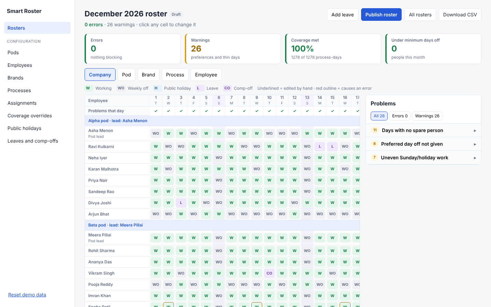
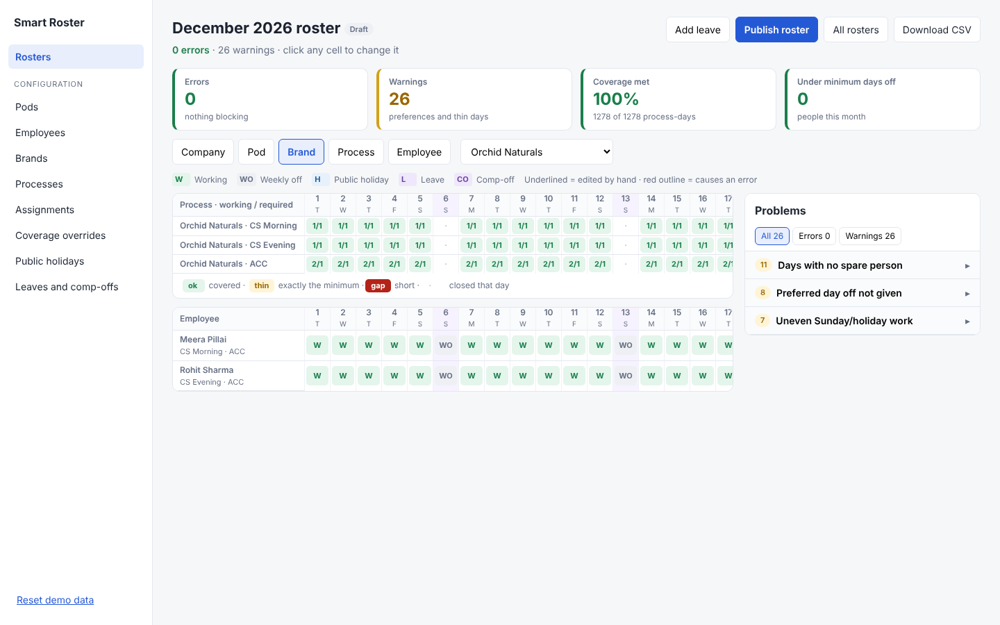
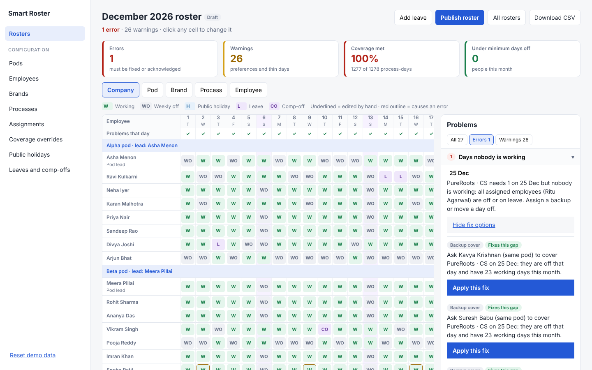
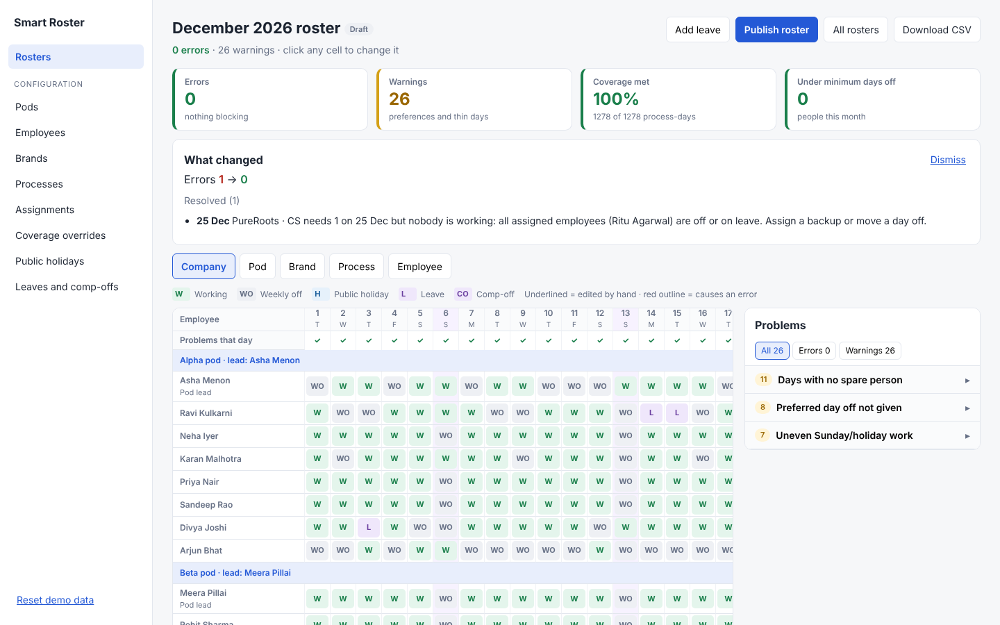

# Smart Roster Management System

Hi! This is my submission for the DataStraw AI internship assessment.

It's a web app that helps an operations manager plan a monthly roster for 30+ people spread across pods, brands and processes. You click one button and it builds the month's roster. It then checks that every process has enough people every day, and it points out any problems in plain English. If someone suddenly goes on leave, it shows what breaks and suggests ways to fix it.

I focused on getting the scheduling right and the conflict detection clear, rather than making the screens fancy.

- **Live app:** https://smart-roster-53xr.onrender.com
- **Demo video:** https://drive.google.com/file/d/1J8jMp-_td8uZDnOcxiDLCu7osaLMctG7/view?usp=sharing
- **LinkedIn:** https://www.linkedin.com/in/sohamjathar
- **Built with:** Python (FastAPI, SQLAlchemy, Google OR-Tools) · React + Vite + TypeScript · SQLite (can switch to PostgreSQL)
- **Tests:** 82 backend tests (`pytest`) and 14 frontend tests (`vitest`), all passing



## What the app can do

- Store pods (with their leads), employees, brands, processes and who works on what. All of this is edited through forms, so no code changes are needed.
- Set the rules for each process: which weekdays it runs, whether it runs on public holidays, how many people it needs at minimum, special days that need more people, and an optional shift time.
- Record weekly offs and preferences, leaves, comp-offs and public holidays.
- Generate a whole month, then look at it by Company, Pod, Brand, Process or Employee.
- Show a quick summary (errors, warnings, how much coverage is met, who has too few days off) and a Problems panel on the side. Click a problem to jump to it. You can also change any cell by hand, and it is re-checked straight away.
- Add a leave and **preview what it would break before applying it**. For a coverage gap, it suggests fixes: ask a backup person, swap someone's day off, or re-plan the days around it.
- Publish the roster. If errors are still open, you have to confirm them first. If you edit a published roster, it goes back to draft. You can also download it as CSV.

## How to run it on your computer

You need Python 3.12 or newer and Node.js. These commands are for Windows PowerShell (on Mac or Linux, use `python3` and `source .venv/bin/activate`).

```powershell
# 1. backend
python -m venv .venv
.venv\Scripts\Activate.ps1
pip install -r backend\requirements-dev.txt
cd backend
python -m uvicorn app.main:app --reload        # API on http://localhost:8000

# 2. frontend (open a second terminal)
cd frontend
npm install
npm run dev                                    # app on http://localhost:5173
```

The first start creates the database and fills it with demo data (32 employees, 4 pods, 25 brands). The "Reset demo data" link in the sidebar puts the demo data back at any time.

To run it as one single service, like it runs when deployed: run `npm run build` inside `frontend`, then `python -m uvicorn app.main:app` inside `backend`, and open http://localhost:8000.

To run the tests: `python -m pytest` inside `backend`, and `npm test` inside `frontend`.

Settings are listed in `.env.sample` (copy it to `.env`): `DATABASE_URL`, `PORT`, `FRONTEND_DIST`, and an optional `DEMO_RESET_TOKEN`. If you set that last one, the reset endpoint needs a matching `X-Demo-Token` header.

## Deployment

The repo has a `Dockerfile` that builds the React app and serves it together with the API from one Python service. It also has a `render.yaml` for Render: choose **New + → Blueprint** and pick this repo.

On my computer the app uses SQLite, a simple file database, so there is nothing to set up. For the live version I use **PostgreSQL on Neon**, so the data is not lost when the app restarts or goes to sleep. To switch, just set `DATABASE_URL` to the Neon connection string (the normal `postgresql://...` one works as it is). The tables and demo data are created automatically the first time the app starts. In `render.yaml` this variable is left empty on purpose, so Render asks for it and the password never goes into GitHub.

I tested the whole flow (generate, add leave, apply a fix, publish, delete, restart) against a real PostgreSQL 16 server, and the data was still there after a restart.

Free hosts go to sleep when idle, so the first page load can take about a minute.

## Try it yourself (3-5 minutes)

1. **Generate:** Rosters → pick December 2026 → *Generate roster*. You get 0 errors and some warnings (preferences that lost to coverage, and days with no spare person).
2. **Look at different brands:** In Brand view, open *Lumen Skincare* (CS runs all 7 days, ACC runs Mon–Sat) and *Orchid Naturals* (has Morning and Evening shifts). In Process view, open *Nimbus Home · CS* (needs 2 people every day).
3. **Spot a conflict:** Click any cell and mark someone as Leave. The new error appears in the Problems panel right away.
4. **Handle a leave:** *Add leave* → Ritu Agarwal (the only person on PureRoots, which works on public holidays) on 25 Dec → *Check impact* (errors go 0 → 1) → *Apply* → *Find fix options* → apply the top backup. A *What changed* card shows errors going 1 → 0.
5. **Publish:** Click *Publish roster*. If an error is still open, the app makes you confirm it first.





I also wrote a script for the demo video: [docs/demo-script.md](docs/demo-script.md).

## How it works inside

```
React UI ──▶ FastAPI routes ──▶ loader ──▶ Snapshot (plain Python data)
                                              │
              calendar_rules · validator · solver · changes · coverage   (pure Python, no database)
```

The most important design choice is that the scheduling logic never touches the database or the web layer. A loader reads the database once and builds a read-only snapshot, and all the logic works on that. This makes it much easier to test and to reason about.

The generator and the checker are two separate things on purpose. The **solver** builds a roster. The **validator** checks any roster, including one you edited by hand. So even if the solver had a bug, the validator would still catch the problem.

**What the validator checks**

| Type | Code | What it means |
|---|---|---|
| Error | `NO_COVERAGE`, `UNDERSTAFFED` | A process is open but nobody (or too few people) is working |
| Error | `WORK_ON_LEAVE` | Someone is scheduled on a day they are on leave or comp-off |
| Error | `REST_RULE` | More than 6 working days in a row |
| Error | `MIN_OFF_DAYS` | Fewer than 4 days off in the month |
| Error | `SHIFT_OVERLAP` | Same person on two processes whose shift times overlap |
| Warning | `PREF_OFF_VIOLATED`, `FIXED_OFF_VIOLATED` | A preferred or fixed weekly off could not be given |
| Warning | `THIN_COVERAGE` | Exactly the minimum number of people (2 or more) is working, with no spare |
| Warning | `UNFAIR_HOLIDAY_WORK` | Someone works 2 or more extra Sundays/holidays than the team average |

Every message names the brand, process, person and date, so the manager knows exactly where to look.

## Assumptions I made

- Each person has **one status per day**: working, weekly off, holiday, leave or comp-off. Working hours and payroll are out of scope.
- **Shifts are optional labels.** Most processes are just "General". Only processes with a real shift time are checked for overlap.
- A person works at most **6 days in a row** and gets at least **4 days off a month**. These are the defaults in `Params` in `backend/app/domain.py`. Changing them means editing code; they are not a setting in the UI yet.
- Working on a Sunday or holiday is only done when coverage needs it, and I keep a count so it stays fair. Comp-offs are recorded like leave; they are not scheduled automatically.
- Only **primary** assignments count towards coverage. A one-off backup is saved on that day's entry and counts for the process it covers.
- There is one shared public holiday calendar. The sample holiday dates are approximate and can be edited.
- The "6 days in a row" count starts fresh on the 1st, because the previous month is not loaded.
- There is no login, no roles and no notifications. It is a single-manager demo.
- In the sample data, brands with only one person run Mon–Sat (or Mon–Fri). One person cannot cover 7 days a week under the 6-day rule, and the validator would say so.

## How do I think? (answers to the assessment questions)

**1. How did you model employees, brands, processes, pods and how they relate?**
A pod has employees and a lead (the lead is also an employee). A brand has one or more processes. Each *process* holds its own rules: which weekdays it runs, whether it is closed on public holidays, the minimum headcount, any special-day overrides and an optional shift time. *Assignments* connect employees to processes (many-to-many), with a role of primary or backup. So one person can work on several processes or brands, and a process can be shared by several people. Leaves, comp-offs and holidays are separate tables. A roster is simply one row per employee per day with a status. This way, *when a brand operates* (a property of the process) is kept apart from *who is working when* (the roster).

**2. How does the system generate a roster, and how does it know the constraints are met?**
I used Google OR-Tools (CP-SAT). It gets a yes/no choice for every employee on every day. Coverage, the 6-day rest rule and the minimum-days-off rule are added as constraints, with a heavy penalty if they cannot be met. Preferences and fairness are lighter goals. After the solver gives an answer, a separate validator reads only the finished roster and checks every rule again. The validator is the final judge, so neither a solver bug nor a manual edit can hide a violation.

**3. How do brands with a single employee differ from brands with many?**
They use the same model. A single-person brand is just one employee assigned to all of that brand's processes, and a bigger brand spreads or shares the processes among several people. The difference shows up in the numbers: with one person, any day off or leave on an operating day becomes a gap, so those brands never run 7 days a week. Bigger brands can run every day because people take turns, and the validator counts how many people are left when one is away.

**4. What happens when the person who handles all of a brand's processes is unavailable on a required day?**
The validator raises a `NO_COVERAGE` error that names the brand, the process and the date, and it shows up in the Problems panel and the Brand view. *Find fix options* then ranks the choices: a backup person (anyone free that day, preferring the same pod, then people already linked to the process, then the person with the lowest workload, with the rest and shift rules re-checked), swapping a day off with an assigned person, or re-planning the days around the gap. Each option states whether it fully fixes the gap, and that is checked before it is shown. Nothing is applied until the manager chooses it.

**5. How do you handle conflicting requirements or not enough staff?**
Never silently. Coverage is a hard rule that beats any preference, so a preferred day off loses to coverage and is shown as a warning. If coverage cannot be met at all, the solver still returns the best roster it can, plus the exact shortfalls (which day, which process, how many people are missing, and who is off). The manager sees each one as an error and cannot publish without confirming it.

**6. What is automated and what is left to a human?**
Automated: building the month, checking every rule, previewing what a leave would break, and ranking fixes. Left to the human: approving leave, choosing and applying a fix, hand edits (these are locked so a re-plan won't undo them), and publishing. The manager is responsible for the roster and might knowingly accept a gap, so that final call stays with them.

**7. What if the company doubled its team and brands?**
I would move to PostgreSQL and solve one pod or brand group at a time instead of one big model. Generating would become a background job with a progress bar. I would re-plan only a window around a change (the code already supports this) rather than the whole month. The grid would be paginated or virtualised, and the coverage numbers cached. I would also add per-brand holiday calendars, roles and permissions, and an audit history.

**8. What would you add with one more week?**
Coverage per shift (how many people in the morning and evening separately) instead of per day. A pod-lead approval step, and notifications when a published roster changes. Carrying the rest streak and fairness counts across months. Comparing two plans side by side. Login. Browser end-to-end tests. And AI-written explanations of conflicts on top of the template messages I use now.

## Short approach note

The roster is built with a constraint solver (coverage, rest, minimum days off, preferences, fairness) and independently checked by a plain Python validator that every manual edit also passes through. The scheduling core is pure Python over a read-only snapshot, with a thin FastAPI layer and a React UI on top. My priorities were reliable scheduling, correct coverage and clear conflict detection, rather than lots of features. The change flow (preview a leave, ranked fixes, publish gate) shows how the system copes with changes after the roster is generated.

## Project layout

```
backend/app/   domain · calendar_rules · validator · solver · changes · coverage   (scheduling core)
               models · db · loader · seed · schemas · routers/ · static · main   (the app around it)
backend/tests/ one test file per module
frontend/src/  pages/ · components/ · hooks/ · lib/ · api.ts · resources.ts
docs/          design spec, implementation plan, screenshots, demo script
```